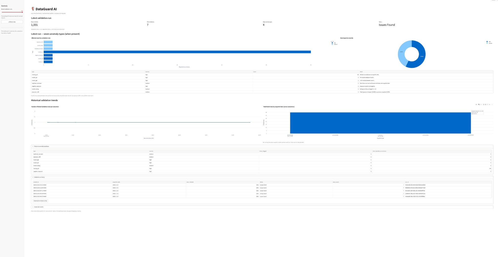
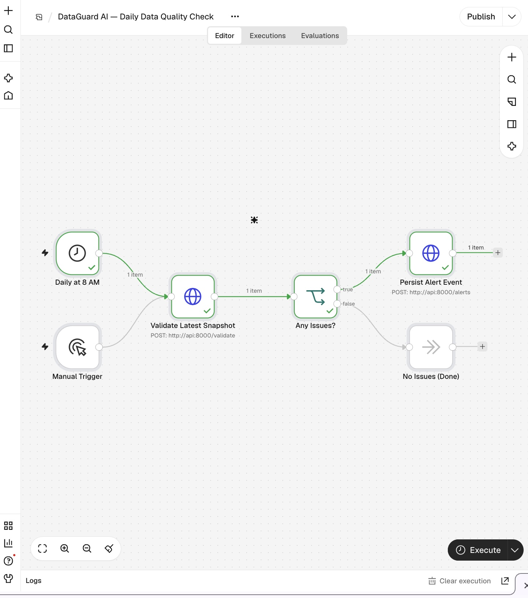
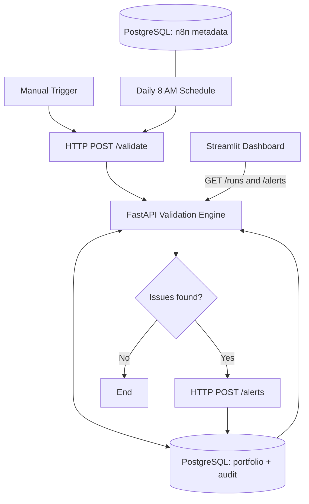

<div align="center">

# 🛡️ DataGuard AI

### Automated Financial Data Quality Monitoring

**Detect anomalies · Orchestrate validations · Explore quality trends**

[](https://www.python.org/)
[](https://fastapi.tiangolo.com/)
[](https://n8n.io/)
[](https://www.postgresql.org/)
[](https://streamlit.io/)
[](https://www.docker.com/)

**Local-first • Open-source-ready • Synthetic data only • No paid AI API required**

[Overview](#-overview) · [Screenshots](#-screenshots) · [Architecture](#-architecture) · [Quick Start](#-quick-start) · [API](#-api-reference)

</div>

---

## 🎯 Overview

**DataGuard AI** is an end-to-end, local data-quality monitoring project for *synthetic loan portfolios*. Python and FastAPI perform reproducible validation, PostgreSQL records the results, n8n orchestrates monitoring and alert logging, and Streamlit makes findings easy to explore.

It is designed as a portfolio demonstration of **data engineering, automation, API development, database design, and analytical visualization**. Despite the project name, the current version uses **deterministic rules, not a paid AI model or LLM-generated explanations**.

### Sample validation results

Results from an intentionally faulty **November 18, 2026** synthetic snapshot:

| Records checked | Failed rule types | High-severity types | Status |
| :---: | :---: | :---: | :---: |
| **1,001** | **7** | **4** | **Issues found** |

| Anomaly | Severity | Observed finding |
|---|---|---|
| Missing probability of default (PD) | 🔴 High | 30 missing values (about 3.0%) |
| Invalid PD | 🔴 High | 1 invalid value |
| Invalid loss given default (LGD) | 🔴 High | 1 invalid value |
| Duplicate borrower + snapshot date | 🟠 Medium | 1 duplicate occurrence |
| Negative exposure | 🔴 High | 1 invalid value |
| Invalid risk rating | 🟠 Medium | 1 invalid value |
| Portfolio exposure shift | 🟠 Medium | **+28.89%** versus prior snapshot |

> The numbers above are from a seeded demonstration snapshot—not production data or a claim about a real financial institution. Counts can overlap and should not be summed as unique affected borrowers. The validator also supports a missing-LGD check, which was not triggered in this sample run.

## 📸 Screenshots

### Streamlit monitoring dashboard

View rule failures, affected counts, severity distribution, audit history, and alerts.



### n8n workflow execution

Scheduled/manual trigger → FastAPI validation → issue routing → alert persistence.



## ✨ Features

| Capability | Implementation |
|---|---|
| **Automated validation** | Python rules for missing and invalid risk values, duplicates, negative exposure, ratings, and exposure shifts |
| **Workflow orchestration** | n8n schedule trigger (8:00 AM by default) and manual testing |
| **API layer** | FastAPI endpoints for validation, audit history, and alerts |
| **Audit trail** | PostgreSQL tables for portfolio snapshots, validation runs, and alert events |
| **Visual analytics** | Streamlit KPI summary, anomaly and severity charts, historical trends, and CSV export |
| **Reproducible demo** | Docker Compose and a deterministic synthetic data generator |
| **No paid AI dependencies** | Entire MVP runs locally without OpenAI, Anthropic, or cloud AI credentials |

## 🧩 Architecture



- **FastAPI** is the source of validation results and audit APIs.
- **n8n** invokes the API and writes an alert event when rules fail.
- **Streamlit** reads validation and alert history via FastAPI; it does not write to PostgreSQL directly.
- PostgreSQL holds separate application and n8n databases.
- Within Docker, the API is accessed using `http://api:8000`; from your Mac it is `http://localhost:8000`.

## 🛠️ Tech stack

| Layer | Technologies |
|---|---|
| Validation and REST API | Python, FastAPI |
| Database | PostgreSQL 16 |
| Workflow orchestration | n8n |
| Dashboard | Streamlit, Plotly, Pandas |
| Containerization | Docker Compose |
| Testing | pytest |

## 🚀 Quick Start

### Requirements

- Docker Desktop (or Docker Engine + Compose)
- Git and a terminal
- Available ports: **5678** (n8n), **8000** (API), **8501** (dashboard), **5433** (PostgreSQL on host)

### 1. Clone the repository

```bash
git clone https://github.com/nikhildahiyaa/dataguard-ai-n8n.git
cd dataguard-ai-n8n
```

### 2. Configure local secrets

```bash
cp .env.example .env
```

Replace the example values for `POSTGRES_PASSWORD` and `N8N_ENCRYPTION_KEY` in `.env` with **two different** long random secrets. You can generate them with `openssl rand -hex 32`. Do not commit `.env`.

### 3. Start the backend and automation

```bash
docker compose up -d --build
docker compose ps
```

### 4. Seed the database (first-time demo setup only)

```bash
docker compose run --rm seed
```

> **Destructive operation:** the seeder resets the loan portfolio, validation runs, and alert history. Run it only when you intentionally want to reset your demo dataset; do **not** rerun it when trying to preserve existing results.

### 5. Run a validation

```bash
curl http://localhost:8000/health
curl -X POST http://localhost:8000/validate \
  -H 'Content-Type: application/json' \
  -d '{}'
```

### 6. Set up n8n

1. Open **http://localhost:5678** and complete its local account setup.
2. Create/open a workflow and choose **Import from File**.
3. Import [`workflows/daily_monitor.json`](workflows/daily_monitor.json).
4. Click **Execute workflow** to test the alert branch.
5. Publish/activate the workflow **only if** you want the scheduled 8:00 AM automation to run.

### 7. Start the Streamlit dashboard

```bash
docker compose -f docker-compose.yml -f docker-compose.dashboard.yml up -d --build dashboard
```

Open **http://localhost:8501**, then use **Refresh data** to load current validation runs. The dashboard reads local FastAPI endpoints and requires no third-party credentials.

### 8. Inspect saved results

```bash
curl http://localhost:8000/runs
curl http://localhost:8000/alerts
```

## 🔌 API Reference

| Method | Endpoint | Description |
|---|---|---|
| `GET` | `/health` | Health check |
| `POST` | `/validate` | Validate latest or specified snapshot; save validation run |
| `POST` | `/alerts` | Store alert for an existing validation run |
| `GET` | `/runs` | View recent validation results |
| `GET` | `/alerts` | View recent alert events |
| `GET` | `/docs` | Swagger / OpenAPI interface |

Example request targeting a specific synthetic snapshot:

```bash
curl -X POST http://localhost:8000/validate \
  -H 'Content-Type: application/json' \
  -d '{"snapshot_date":"2026-11-18"}'
```

## 🧪 Testing

```bash
docker compose run --rm --no-deps seed python -m pytest -q tests
```

The included tests focus on deterministic validation logic; they are **not** full end-to-end database integration tests.

## 🗂️ Project Structure

```text
dataguard-ai-n8n/
├── api/                         # FastAPI endpoints and validation logic
├── dashboard/                   # Streamlit UI and container build
├── data/                        # Synthetic dataset generator
├── database/                    # PostgreSQL initialization schema
├── docs/
│   ├── architecture.md
│   └── screenshots/              # Real local demo screenshots
├── tests/                       # Validation unit tests
├── workflows/
│   └── daily_monitor.json       # Importable n8n workflow
├── docker-compose.yml
├── docker-compose.dashboard.yml
├── Dockerfile
├── requirements.txt
├── .env.example                  # Safe example configuration
└── README.md
```

## 🔐 Security and Limitations

- **Synthetic data only.** Do not upload employer, borrower, or other confidential data.
- **Local-development deployment.** Service ports are bound to `127.0.0.1`. Authentication, TLS, access controls, and additional hardening are required before any public deployment.
- Keep `.env`, tokens, keys, and credential-bearing workflow exports out of GitHub.
- Thresholds are **demonstration assumptions**, not institution-approved credit policy.
- Snapshot-level exposure comparisons can flag changes without establishing the cause.
- Historical dashboard trends represent stored validation **executions**, so repeat validations of one snapshot appear more than once.
- The current dashboard displays up to the API's recent-history window; it is not a full historical data warehouse.

## 🧭 Future Improvements

- [ ] Quality scoring and filters by borrower segment and snapshot date
- [ ] Alert deduplication and optional email/Slack integrations
- [ ] CI checks and full API/database integration tests
- [ ] More realistic multi-day synthetic anomaly trends
- [ ] Optional local-model anomaly summaries (no paid API required)

---

<div align="center">

**Built as a portfolio project to demonstrate financial data validation, API engineering, automation, and analytics.**

[Back to top](#️-dataguard-ai)

</div>
